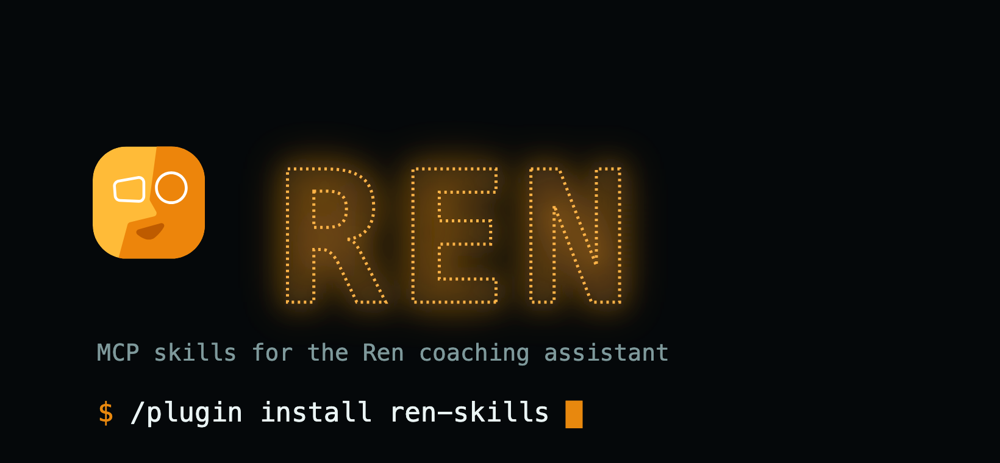

# Ren skills

Six ready-made playbooks for working with [Ren](https://tryren.com) — your
AI coaching assistant — straight from Claude Code. One install gets you all
six skills plus the Ren MCP server connection, no per-file downloads.

## Install

```
/plugin marketplace add Good-Authority/ren-skills-plugin
/plugin install ren-skills
```

That's it — Claude Code now has all six skills below, and is connected to
Ren's MCP server.

## What's inside

| Skill | What it does |
|---|---|
| `getting-started-cold-start` | Walks a brand-new workspace through inviting a team and reaching the first real brief. |
| `daily-brief` | Pulls today's brief from Ren and relays it, with the right follow-up tool for each item. |
| `one-on-one-prep-and-close-out` | Preps a 1:1 with calendar, Slack, Granola and Linear context, then logs the outcome back. |
| `dial-aware-feedback` | Turns a situation into a draft on Ren's Accountability Dial — never sent without your explicit OK. |
| `weekly-team-pulse` | A one-page view of team health: Plan/1:1 completion, nudges, and what's moving on the Dial. |
| `transcript-to-ren-context` | Sends a meeting transcript to Ren so coaching reflects the real conversation. |

## Example

```
$ /plugin install ren-skills
✔ Installed ren-skills — 6 skills, 1 MCP server connected

> /ren-skills:daily-brief
Pulling today's brief from Ren...

Ren: Sam's 1:1 recap is in — worth a look before your sync at 2pm.
Ren: Priya hasn't logged a Plan update in 9 days.
Ren: Ready to draft a check-in for Priya?
```

## For ChatGPT or Cursor

Claude Code plugins aren't a format those tools read. Grab what you need
straight from this repo instead — open any `skills/<name>/SKILL.md` file and
copy its contents, or use GitHub's "Download ZIP" button on this repo for
all six at once.

## Contributing

Skills are plain markdown. Open a PR against a `skills/<name>/SKILL.md` file
to propose a change — once merged to `main`, it's live.
